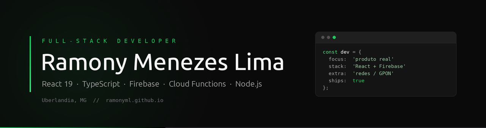

<p align="center">
  <a href="https://ramonyml.github.io"></a>
  <a href="https://www.linkedin.com/in/ramonyml"></a>
  <a href="https://wa.me/5534999886329"></a>
  <a href="mailto:ramonyml@gmail.com"></a>
</p>

---

Desenvolvedor full-stack com produtos rodando em produção de verdade, não só em portfólio. Hoje trabalho em um ERP fiscal-financeiro multi-tenant que emite nota fiscal para empresas em dezenas de municípios brasileiros — NFS-e, NF-e e CT-e, cada prefeitura com seu próprio padrão e suas próprias regras de rejeição. Também sou o desenvolvedor principal da **FISCO API**, um motor próprio de emissão fiscal que fala direto com a Receita, as SEFAZ e as prefeituras: NFS-e, NF-e, CT-e e MDF-e, com cada documento conferido no leiaute oficial e em centenas de regras de rejeição antes do envio. Antes disso construí sozinho, do zero, uma plataforma operacional usada todo dia pelo suporte técnico de um provedor de fibra óptica, integrada por API ao ERP da operação, e um SaaS com checkout próprio e assinaturas ativas.

Antes de migrar pra desenvolvimento, passei alguns anos em infraestrutura de redes (GPON/XPON, monitoramento via Zabbix). Isso me dá um domínio técnico pouco comum em projetos que encostam em telecom e provedores. Minha formação em Análise e Desenvolvimento de Sistemas tem ênfase em engenharia de software e documentação técnica: gosto de deixar cada decisão registrada o suficiente pra outra pessoa dar manutenção sem sofrer.

```
Uberlândia, MG   ·   Freelance & vagas CLT/PJ   ·   Presencial, híbrido ou remoto
```

<br />

## Em produção

### Handzo
**ERP fiscal-financeiro · multi-tenant white-label · DEVIA**

Plataforma de emissão de notas fiscais e gestão financeira para PMEs brasileiras e escritórios de contabilidade, com clientes emitindo todos os dias.

`NFS-e · NF-e · CT-e` `Open Finance` `Emissão por WhatsApp`

Emissão de NFS-e nos padrões **Nacional (DPS)** e **ABRASF municipal** via Focus NFe, com cerca de doze camadas de validação antes de consumir numeração fiscal — porque número queimado abre buraco na série e não se conserta sozinho. Inclui Reforma Tributária (IBS/CBS, CST e cClassTrib), substituição de nota no padrão federal, conciliação bancária por Open Finance e cobrança recorrente.

O diferencial do produto é **emitir nota fiscal pelo WhatsApp**: o cliente descreve a nota no chat e recebe o PDF autorizado na mesma conversa.

<sub>React 18 · TypeScript · Vite · Tailwind · shadcn/ui · Supabase (PostgreSQL + RLS + Edge Functions em Deno) · TanStack Query · Focus NFe · Pluggy · Asaas · Vercel</sub>

<sub>Produto da Hands Business, sob contrato da DEVIA · código proprietário</sub>

<br />

### JUBATRIM
**Site institucional e loja online · Juventude Batista do Triângulo Mineiro**

Site oficial de uma juventude batista com projetos missionários e congressos (agenda, galeria, temas visuais por evento e uma página de links da bio) e a loja dela, com painel administrativo para a equipe atualizar tudo sem mexer em código.

`PIX na Asaas` `Next.js 16 · Cache Components` `Painel sem código`

A loja tem galeria com zoom em alta resolução, checkout com PIX e webhook idempotente (o estorno cancela o pedido sozinho), retirada no evento ou Correios via SuperFrete, conta de cliente com Google ou e-mail e senha, avaliações só de quem comprou e acompanhamento de pedido sem login por código. E-mails transacionais com domínio próprio via Resend, suporte com resposta direta ao cliente e fotos de produto enviadas pelo painel, redimensionadas no navegador e guardadas no Vercel Blob.

<sub>Next.js 16 · React 19 · TypeScript · Tailwind CSS 4 · Motion · Lenis · Firebase (Firestore, Auth, Admin SDK) · Vercel Blob · Asaas · SuperFrete · Resend · Zod · Python/Pillow · FFmpeg · Vercel</sub>

[**jubatrim.com.br**](https://jubatrim.com.br) <sub>· repositório privado</sub>

<br />

<table>
<tr>
<td width="50%" valign="top">

### Eterno Dia
**SaaS próprio · com clientes pagantes**

Álbum colaborativo em tempo real para eventos. Os convidados enviam fotos e vídeos por link ou QR Code, sem instalar nada e sem criar conta.

`3 planos` `Stripe + Asaas` `Tempo real`

Checkout com dois gateways, crop de imagem no navegador, download do álbum em ZIP e painel de moderação para o organizador.

<sub>React 19 · Vite · Tailwind CSS 4 · Firebase · Stripe · Asaas</sub>

[**eternodia.com**](https://eternodia.com) <sub>· código proprietário</sub>

</td>
<td width="50%" valign="top">

### Gerador de O.S.
**CRM autoral para provedores · desde dez. 2023 · v4.0.1**

CRM operacional de minha autoria, criado e mantido por mim em infraestrutura própria: hub de demandas do suporte, chamados internos estilo GLPI, escala de turnos, agenda de visitas técnicas, condomínios, upgrades e comissões, comunicados e gestão de usuários.

`37 formulários` `170 variantes` `~70 mil linhas TS`

Acesso em três camadas (rotas, regras do Firestore e Cloud Functions) por setor, hierarquia e papéis. Uma Cloud Function orquestra a integração com o ERP MK Solutions por 8 endpoints REST: abre o protocolo, insere os comentários e cria a O.S., com credenciais no Secret Manager. Usado diariamente no suporte de um provedor de fibra, **levou o atendimento de 10 a 15 minutos para menos de 2.**

<sub>React 19 · TypeScript · Vite · Material UI · Firebase · Cloud Functions · Secret Manager · Vitest</sub>

<sub>Software autoral · código e infraestrutura de minha titularidade, repositório privado</sub>

</td>
</tr>
<tr>
<td width="50%" valign="top">

### HT Glow Fit
**Cliente real · moda fitness feminina**

Loja completa para uma marca 100% online, com domínio próprio. Carrinho com reserva de estoque server-side (transação no Firestore evita vender a mesma peça duas vezes), checkout convidado com PIX e frete calculado por CEP.

`PIX na Asaas` `Frete SuperFrete` `Dashboard`

Pedido pago dispara e-mail para a loja via Resend. Login de cliente (e-mail/senha e Google) e painel admin em rota oculta, com dashboard de vendas, controle de estoque e gestão de pedidos.

<sub>Next.js · TypeScript · Firebase · Asaas · SuperFrete · Vercel</sub>

[**htglowfit.com**](https://htglowfit.com)

</td>
<td width="50%" valign="top">

### Escala Memorial
**Gestão de ministério de igreja · louvor e mídia**

App do grupo de louvor e da equipe de mídia de uma igreja batista: o líder cadastra os cultos e monta a escala, e cada membro marca em quais dias pode servir e vê onde foi escalado. Pensado primeiro para o celular.

`3 papéis + RLS` `Lembretes por e-mail` `Imagem pro WhatsApp`

Permissões por papel direto no Postgres (RLS), convites e contas em Edge Functions, lembretes diários agendados com pg_cron e enviados uma vez só via Resend, playlist do culto com arrastar e soltar e card da escala desenhado em canvas e compartilhado pela Web Share API.

<sub>React 19 · TypeScript · Vite · Tailwind CSS 4 · shadcn/ui · TanStack Query · Supabase (Postgres + RLS + Edge Functions) · pg_cron · Resend · Vitest · Vercel</sub>

[**memorial-escala.vercel.app**](https://memorial-escala.vercel.app) <sub>· repositório privado</sub>

</td>
</tr>
<tr>
<td width="50%" valign="top">

### Elegancy NR Nails
**Cliente real · nail designer em Uberlândia**

Site e agenda online, com domínio próprio, para uma profissional que atende a domicílio e em espaço de atendimento. A cliente escolhe o cuidado, o local e um horário livre, calculado com o tempo de deslocamento entre um atendimento e outro.

`Agenda sem login` `Push no celular` `Painel PWA`

A reserva passa por uma função no servidor e uma restrição de exclusão no Postgres impede dois atendimentos no mesmo horário. Confirmação e lembretes por e-mail, notificações push para a profissional e painel pensado para o celular, com galeria do site editável.

<sub>HTML · CSS · JavaScript · Supabase · PostgreSQL · Edge Functions · Resend · Web Push · Vercel</sub>

[**elegancynrnails.com.br**](https://elegancynrnails.com.br) <sub>· código proprietário</sub>

</td>
<td width="50%" valign="top">

### Ludi
**Arquivo de cosplay · 10 personagens**

Site de exposição do arquivo pessoal de uma cosplayer, com 34 fotos curadas. A interface é uma ficha de personagem impressa, com réguas, molduras de canto e numeração à mostra, e a seção de elenco reinterpreta a tela de seleção de campeão do League of Legends.

`Zero build` `View Transitions` `LCP 252 ms`

Tema claro e escuro com a mesma dupla de cores de papéis trocados; a troca abre em círculo a partir do próprio botão. 770 KB na carga inicial.

<sub>HTML · CSS · JavaScript · View Transitions · Vercel</sub>

[**sailorlu.vercel.app**](https://sailorlu.vercel.app) <sub>· repositório privado</sub>

</td>
</tr>
</table>

<br />

## Em desenvolvimento

### Lorrana Pinto
Site com agendamento próprio para uma psicóloga que atende online e presencialmente no Pará. A direção visual parte da logo dela, uma peça de quebra-cabeça com coração: paleta creme, amarelo e terracota, grão de impressão antiga, o retrato que chega em quatro peças e se encaixa, um quebra-cabeça que o visitante monta e revela um recado, e dúvidas em que cada pergunta é uma peça que encaixa ao abrir.

O motor de agenda, em **TypeScript puro com testes**, reserva horário sem cadastro e sem senha e respeita o Código de Ética do CFP e a LGPD desde o desenho.

<sub>HTML · CSS · JavaScript · Next.js 16 · TypeScript · Firebase · Vercel</sub>

[**lorranapintopsicologa.vercel.app**](https://lorranapintopsicologa.vercel.app) <sub>· prévia em aprovação com a cliente · repositório privado</sub>

<br />

### Studio Jê Cunha
Landing page editorial para um studio de estética e micropigmentação em Marituba, PA, campeão nacional de micropigmentação em 2025. Tipografia serifada editorial, paleta porcelana com salmão e dourado, scroll suave com Lenis, galeria de resultados com arraste, vídeos que só tocam em vista e preview de imagem que segue o cursor na lista de serviços.

<sub>HTML · CSS · JavaScript · Lenis</sub>

[**jecunha.vercel.app**](https://jecunha.vercel.app) <sub>· em aprovação com a cliente</sub>

<br />

### Samyra Priscila
Página de apresentação e hub de links para uma criadora de conteúdo de beleza com 1,4 milhão de seguidores somados no Instagram, TikTok e YouTube. Bodoni Moda com tamanho óptico travado, paleta porcelana com cacau e caramelo, galeria arrastável com vídeos que só tocam em vista e texto todo em primeira pessoa.

<sub>HTML · CSS · JavaScript · Lenis · Vercel</sub>

[**samyrapriscila.vercel.app**](https://samyrapriscila.vercel.app) <sub>· em aprovação com a cliente · repositório privado</sub>

<br />

### Sapiens Contabilidade
Landing page para um escritório de contabilidade em Joinville, SC, focado em micro e pequenas empresas, com destaque para oficinas mecânicas. Cormorant Garamond e Jost, marinho e turquesa da marca, abertura em que a logo surge e a cortina sobe, seletor para a cliente comparar três versões da logo na página inteira, formulário de proposta com consentimento LGPD e SEO com dados estruturados.

<sub>HTML · CSS · JavaScript · Lucide · Vercel</sub>

[**sapiens-contabilidade.vercel.app**](https://sapiens-contabilidade.vercel.app) <sub>· em aprovação com a cliente · repositório privado</sub>

<br />

### OSLine
SaaS white-label para provedores regionais de internet, generalizando os conceitos operacionais do Gerador de O.S. (chamados, escala, chat interno) para atender vários provedores-clientes ao mesmo tempo.

Arquitetura **multi-tenant no Firestore**, com isolamento de dados por tenant em cerca de 24 coleções e permissões por setor e hierarquia.

<sub>React 19 · TypeScript · Firestore Multi-Tenant · Firebase</sub>

<br />

## Produtos à venda

Templates de landing page prontos para publicar, em HTML + Tailwind via CDN, sem etapa de build. Vendidos como arquivo ou com a identidade visual do cliente aplicada por mim.

| Produto | Nicho | Destaque técnico |
| :--- | :--- | :--- |
| **Obscura** | Fotografia | Scroll horizontal pinado, lightbox em tela cheia, cursor customizado |
| **Jogaê** | Comunidade gamer | Glitch RGB, piso holográfico, countdown de torneio, easter egg Konami |
| **Apetite** | Restaurante e delivery | Slider de pratos com arraste, cardápio em abas, pedido por WhatsApp |
| **Vigor** | Academia e personal | Contador de resultados animado, planos com destaque |
| **Belle Studio** | Salão de beleza | Hero animado, catálogo de serviços, galeria e planos |
| **Studio Nova** | Multi-nicho | 4 paletas prontas, FAQ acessível sem JS |
| **Exata Contábil** | Contabilidade | Fundos fotográficos com parallax entre seções |

<sub>Demos ao vivo em [ramonyml.github.io](https://ramonyml.github.io)</sub>

<br />

## Stack

**Front-end**


**Back-end e cloud**


**Integrações**


**Qualidade e ferramentas**


**Redes e infra**


<br />

## Trajetória

```
ago/2026 — atual   Desenvolvedor Full-Stack
                   DEVIA · Serviços e Desenvolvimento Tecnológico
                   Handzo (Hands Business) — ERP fiscal-financeiro
                   FISCO API — desenvolvedor principal da API própria de emissão fiscal (desde out/2026)

2023 — 2026        Suporte Técnico N3 · Desenvolvedor Full-Stack
                   MZ NET Fibra Óptica, Uberlândia/MG

2021 — 2023        Supervisor de Atendimento e NOC
                   TSJ Telemarketing (PRODEPA), Belém/PA

2019 — 2021        Analista de Relacionamento | NOC
                   TSJ Telemarketing (PRODEPA), Belém/PA

2019 — 2023        Análise e Desenvolvimento de Sistemas
                   Uninter · ênfase em engenharia de software
```

<br />

---

<p align="center">
  <a href="https://ramonyml.github.io"><b>Portfólio completo</b></a>
  &nbsp;·&nbsp;
  <a href="https://wa.me/5534999886329">WhatsApp</a>
  &nbsp;·&nbsp;
  <a href="https://t.me/ramonyml_bot">Telegram</a>
  &nbsp;·&nbsp;
  <a href="https://www.linkedin.com/in/ramonyml">LinkedIn</a>
  &nbsp;·&nbsp;
  <a href="mailto:ramonyml@gmail.com">E-mail</a>
</p>
